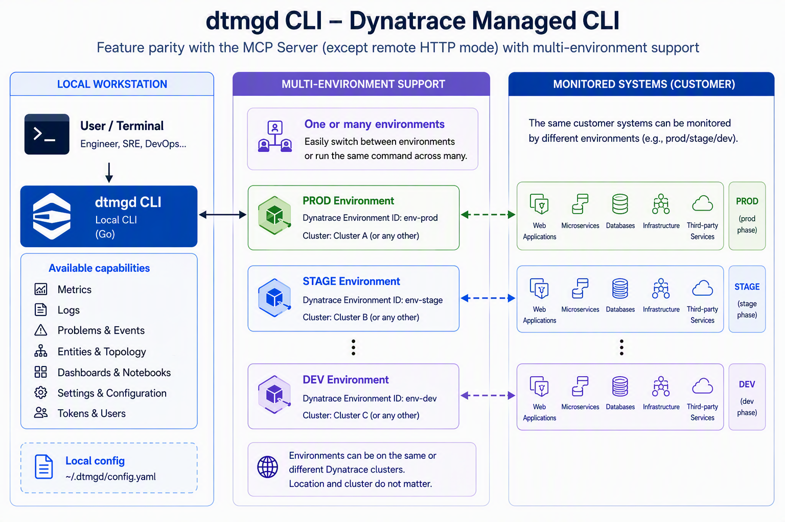

# dtmgd — Dynatrace Managed CLI

`dtmgd` is a `kubectl`-inspired read-only CLI for **Dynatrace Managed** (self-hosted) environments, modeled after [`dtctl`](https://github.com/dynatrace-oss/dtctl).

It gives you terminal access to problems, entities, events, logs, metrics, SLOs, and security vulnerabilities via the Dynatrace Managed classic API — covering every tool of the [Dynatrace Managed MCP Server](https://github.com/dynatrace-oss/dynatrace-managed-mcp); the differences are listed under [Feature Parity](#feature-parity-with-dynatrace-managed-mcp-server).

> [!NOTE]
> This open source product is supported by the community.
> For feature requests, questions, or assistance, please use [GitHub Issues](https://github.com/dynatrace-oss/dtmgd/issues).

## Architecture



`dtmgd` runs entirely on your workstation and talks directly to the Dynatrace
Managed APIs, with no broker and no third-party service in between. Each named
context points at one Dynatrace Managed environment. Environments may live on
the same cluster or on separate clusters, in different locations, running
different Dynatrace versions. Because the same systems are often monitored by
several environments (production, staging, development), a single command can
query one environment or fan out across every environment you have configured.
See [Multi-Environment Queries](#multi-environment-queries).

## API Endpoints

| Target | URL pattern |
|---|---|
| Environment API (observations) | `{host}/e/{env-id}/api/v2/` |
| Cluster management API | `{host}/api/v1.0/onpremise/` |

## Installation

**Option 1 — Homebrew (macOS / Linux)**

```bash
brew install dynatrace-oss/tap/dtmgd

# Upgrades work automatically:
brew upgrade dtmgd
```

**Option 2 — go install (requires Go 1.26.10+)**

```bash
go install github.com/dynatrace-oss/dtmgd@latest
```

**Option 3 — build from source**

```bash
git clone https://github.com/dynatrace-oss/dtmgd.git
cd dtmgd
make install   # installs to $GOPATH/bin (or $HOME/go/bin)
```

Make sure `$(go env GOPATH)/bin` is in your `$PATH`.

## Quick Start

`dtmgd` supports any number of named environments ("contexts"). The name you
choose is only an alias — there are no reserved names. Pick whatever fits
your setup: `prod`, `staging`, `dev`, `eu-prod`, `acme-prod`, anything.

```bash
# 1. Create a context pointing to your Managed cluster.
#    Replace "prod" below with any alias you want for this environment.
dtmgd config set-context prod \
  --host https://managed.company.com \
  --env-id abc12345 \
  --token-ref prod-token

# 2. Store your API token. You are prompted for it, with echo disabled, so it
#    stays out of your shell history. Saved to the OS keyring when available.
dtmgd config set-credentials prod-token

# 3. Verify connectivity, token and cluster version
dtmgd doctor

# 4. List open problems
dtmgd get problems --status OPEN
```

You can repeat step 1 as many times as needed to register additional
environments — there is no limit on the number of contexts, and each can use
any alias you choose. See [Multi-Environment Queries](#multi-environment-queries)
for cross-context fan-out.

> **Note on token storage**: when an OS keyring (macOS Keychain, GNOME Keyring,
> Windows Credential Manager) is available, the token is stored there and the
> config file keeps only an empty placeholder. On headless Linux systems without
> a keyring daemon, the token is stored in plaintext in the config file
> (`~/.config/dtmgd/config`, mode 0600). Run
> `dtmgd config migrate-tokens` any time after a keyring becomes available.

### Supplying the token in scripts and CI

Pipe the token in rather than passing it as a flag:

```bash
echo "$DT_API_TOKEN" | dtmgd config set-credentials prod-token --token-stdin
dtmgd config set-credentials prod-token --token-stdin < /run/secrets/dt-token
```

`--token <value>` still works, but the kernel copies command-line arguments
into the process image at `execve(2)`, so the value is readable from
`/proc/<pid>/cmdline` by any process running as you, and your shell records the
whole line in its history. Nothing dtmgd does after startup can undo that,
which is why it warns when you use the flag.

In CI, prefer skipping stored credentials altogether: reference the variable
from the config with `${DT_API_TOKEN}` (see
[Environment variables in the config](#environment-variables-in-the-config)) and let
the secret live only in the environment. On headless runners there is no
keyring, so a stored token is written to the config file in plaintext — a
`${VAR}` reference never is.

## Authentication

`dtmgd` uses API token-based authentication. Create an API token in your Managed cluster with the required scopes.

For more information about creating API tokens in Managed deployments, refer to the [Dynatrace Managed documentation](https://docs.dynatrace.com/managed/discover-dynatrace/references/dynatrace-api/basics/dynatrace-api-authentication).

### Required API Token Scopes

Your API token needs these scopes for every command to work. Each command
declares the scopes it uses, and a permission error names the ones the failed
command needs; a test keeps this list identical to those declarations.

<!-- scopes:start -->
- Access problem and event feed, metrics, and topology (`DataExport`): `get environments`
- Read entities (`entities.read`): entities, entity types and relations; name lookups in `query metrics` and `query log-counts`
- Read events (`events.read`): events
- Read logs (`logs.read`): `query logs`, `query log-counts`
- Read metrics (`metrics.read`): metrics, `query metrics`
- Read problems (`problems.read`): problems
- Read security problems (`securityProblems.read`): security problems
- Read SLO (`slo.read`): SLOs
<!-- scopes:end -->

> **Note:** API token scopes in Managed deployments differ from SaaS Platform tokens. Ensure you select the correct scopes for your Managed cluster version.

## Commands

### Configuration

```
dtmgd config set-context <name> --host <url> --env-id <id> --token-ref <ref>
dtmgd config set-credentials <name>              # prompts for the token
dtmgd config set-credentials <name> --token-stdin  # reads the token from stdin
dtmgd config get-contexts          # list all contexts
dtmgd config current-context       # show active context name
dtmgd config use-context <name>    # switch active context
dtmgd config delete-context <name> # remove a context
dtmgd config delete-context <name> --delete-credentials  # ... and its token, unless shared
dtmgd config delete-credentials <name>  # delete a token from the keyring and the config
dtmgd config migrate-tokens        # move plaintext tokens to OS keyring
dtmgd config view                  # dump full config (token values masked)
dtmgd config view --show-tokens    # ... including token values
dtmgd config init                  # create .dtmgd.yaml in current directory
dtmgd config import <file>         # create contexts from an MCP server config (see below)
dtmgd config import --from-env     # ... from DT_ENVIRONMENT_CONFIGS
dtmgd ctx                          # shortcut: list or switch contexts
dtmgd ctx [context-name]           # switch context
dtmgd ctx current                  # show current context
dtmgd ctx delete <name>            # delete context
```

#### Importing a Dynatrace Managed MCP server config

If you already run the [Dynatrace Managed MCP server](https://github.com/dynatrace-oss/dynatrace-managed-mcp),
`config import` turns its environments into dtmgd contexts. It reads the file
`DT_CONFIG_FILE` points at (a YAML or JSON array; the extension decides which), or,
with `--from-env`, the JSON in `DT_ENVIRONMENT_CONFIGS`:

```bash
dtmgd config import dt-config.yaml --dry-run   # show what would be created; writes nothing
dtmgd config import dt-config.yaml
dtmgd config import --from-env --overwrite     # replace contexts that already exist
```

| MCP field | dtmgd setting |
|---|---|
| `alias` | context name |
| `apiEndpointUrl` | `host` (trailing `/` trimmed) |
| `environmentId` | `env-id` (trailing `/` trimmed) |
| `apiToken` | token `<alias>-token`, the context's `token-ref` |
| `httpProxyUrl` / `httpsProxyUrl` | `http-proxy` / `https-proxy` |

Other fields, such as `dynatraceUrl`, are ignored with a note. A literal `apiToken` is
stored as `set-credentials` stores one: in the OS keyring, or in the config file when no
keyring is available. An `apiToken` such as `${DT_PROD_TOKEN}` is written to the config as
that reference, never expanded, so the secret stays in the environment variable. An alias
that names an existing context is skipped unless you pass `--overwrite`. If any environment
is invalid (a missing `alias`, `apiEndpointUrl` or `environmentId`, a duplicate alias, or
an alias containing `;`), nothing is written and the command exits 2.

### Get (list resources)

```
dtmgd get environments       # configured contexts and cluster version (connectivity check: use dtmgd doctor)
dtmgd get problems           # --from, --to, --status, --impact, --selector, --entity, --limit, --sort, --watch
dtmgd get entities           # --selector (required), --from, --to, --limit, --sort, --mz
dtmgd get entity-types       # list all entity types; --limit
dtmgd get events             # --from (required), --to, --type, --entity, --limit, --watch
dtmgd get metrics            # --search, --entity, --limit
dtmgd get slos               # --enabled, --limit, --evaluate, --selector (sloSelector DSL), --timeframe, --from, --to, --sort, --show-global, --demo
dtmgd get security-problems  # --risk, --status, --selector, --from, --to, --sort, --limit
```

`get environments` still runs its per-context connectivity check, and prints a
note on stderr pointing to `dtmgd doctor`. That role has moved to `doctor`; in a
coming release `get environments` will list environments from the Cluster API
instead.

> `describe problem` accepts the UUID from the `PROBLEM-ID` column, **not** the
> short `P-XXXXX` display ID shown in the `DISPLAY-ID` column.
>
> Some problem UUIDs are negative integers (e.g. `-6546711275898328738_1776193140000V2`).
> Pass them after `--` to prevent the leading `-` from being parsed as a flag:
> ```
> dtmgd describe problem -- -6546711275898328738_1776193140000V2
> ```

### Describe (detail view)

```
dtmgd describe problem <problem-id>
dtmgd describe entity <entity-id>
dtmgd describe entity-type <type>
dtmgd describe entity-relations <entity-id>
dtmgd describe event <event-id>
dtmgd describe metric <metric-id>
dtmgd describe slo <slo-id>  [--timeframe CURRENT|GTF] [--from ... --to ...]
dtmgd describe security-problem <security-problem-id>
```

By default `describe problem`, `describe slo` and `describe security-problem`
print a readable summary, and the other describe commands print the API object
as YAML. `-o json` or `-o yaml` prints the API object as it is. For
`describe slo`, `--from`/`--to` imply `--timeframe GTF` when `--timeframe` is
not given, so the dates are honoured.

### Query (time-range data)

```
dtmgd query metrics --metric builtin:service.response.time --from now-1h --to now
dtmgd query metrics --metric builtin:host.cpu.usage --from now-24h --resolution 1h
dtmgd query logs --query "error" --from now-1h --to now
dtmgd query logs --query "timeout" --from now-30m --limit 50
dtmgd query logs --query "error" --from now-1h --entity 'type(PROCESS_GROUP),tag("[Environment]Production")'
dtmgd query log-counts --entity 'type(SERVICE),tag("[Environment]Production")' --from now-1h
# Note: type(SERVICE) is auto-converted to type(PROCESS_GROUP) internally (logs are attributed
# to process groups on DT Managed Classic). Services with ERROR-only log level show 0 INFO/WARN.
```

`query log-counts` is computed by dtmgd, so its json, yaml and agent output is
its own shape rather than an API response:
`{"logCounts": [{"service": …, "info": …, "warn": …, "error": …, "total": …}]}`.
A count is `null` (`-` in the table) when the process group fell outside the
API's top-N aggregation window for that level (`--max-services`, at most 100),
so its true count is unknown rather than 0.

### Doctor (connectivity check)

```
dtmgd doctor                 # check every configured context
dtmgd doctor -c prod         # check one context
dtmgd doctor -o json         # rows as JSON (also -o yaml, or -A for an agent envelope)
```

For each context, `doctor` checks that it resolves, that its token is stored,
that the cluster answers, and that the cluster version is at least 1.328.0, the
oldest version the Dynatrace Managed MCP server supports. It prints one row per
context (`CONTEXT HOST ENV-ID STATUS VERSION DETAIL`) with status `ok`, `warn`
or `fail`. When the token cannot read the cluster version (401 or 403), doctor
tries `GET /api/v2/metrics?pageSize=1` instead, as the MCP server does; if that
works, the context is a `warn` with version `unknown`. Contexts are checked in
parallel, up to `--concurrency` (default 10) at a time. `doctor` exits 1 when
any context fails.

### Commands (machine-readable catalog)

```
dtmgd commands               # full catalog: paths, aliases, flags, required token scopes
dtmgd commands --brief       # just the resources of get, describe and query
dtmgd commands -o yaml       # the same as YAML
```

The catalog is JSON by default and is never wrapped in an agent envelope, even
with `-A`. Global flags are listed once, under `global_flags`; each command lists
only its own flags. AI agents can start with `dtmgd commands --brief` to learn
what exists.

## Global Flags

| Flag | Description |
|---|---|
| `--config <file>` | Config file path (default: `~/.config/dtmgd/config`) |
| `-c, --context <name>` | Override current context |
| `-e, --env <spec>` | Target environment(s): context name, `"prod;staging"`, or `ALL_ENVIRONMENTS` |
| `-o, --output <format>` | Output format: `table` (default), `wide`, `json`, `yaml` (or `yml`); any other value is a usage error (exit 2) before any request is made |
| `-A, --agent` | Force AI agent envelope output (`{ok, result, context}`) |
| `--no-agent` | Disable auto-detected agent mode |
| `--plain` | Words instead of symbols on stderr, no screen control (automatic when stdout is not a terminal) |
| `--max-pages <n>` | Maximum pages to fetch (0 = all, default). Pagination is automatic. |
| `--concurrency <n>` | Maximum environments queried at once with `--env` (default: `10`) |
| `--columns <cols>` | Comma-separated columns to show in table output |
| `-v` | Verbose: show HTTP request/response summaries |
| `-vv` | Extra verbose: full headers and body |

`--watch` and `--watch-interval` are flags of `get problems` and `get events`
only; see [Watch Mode](#watch-mode).

## Output

stdout carries only data. Everything meant for a person — "No problems found",
"Showing 10 of 15 problems", warnings, errors and hints — goes to stderr, so
`dtmgd get problems -o json | jq` never sees it.

For every `get`, `describe` and `query` command except `get environments` and
`query log-counts`, `-o json`, `-o yaml` and the agent envelope's `result` are
the API's own response, with its camelCase keys (`problemId`, `totalCount`, `nextPageKey`),
not the table's columns. An empty result prints that object with an empty list
(`"problems": []`) rather than nothing.

`--plain` replaces the stderr symbols (`⚠ ✗ 💡`) with words (`Warning:`,
`Error:`, `Hint:`) and stops `--watch` from clearing the screen. It is on
automatically when stdout is not a terminal or `NO_COLOR` is set, unless
`FORCE_COLOR` is set.

## Exit Codes

| Code | Meaning |
|---|---|
| `0` | Success |
| `1` | Any other error |
| `2` | Usage error: unknown command, resource or flag, a missing argument or required flag |
| `3` | Authentication failed (HTTP 401) |
| `4` | Not found (HTTP 404) |
| `5` | Permission denied (HTTP 403) |

The codes are the ones `dtctl` uses. A multi-environment (`--env`) call exits
non-zero if any environment fails: with the shared code when every environment
failed the same way (all 403 → `5`), otherwise `1`. The environments that
answered are still printed.

## Multi-Environment Queries

Query one, several, or all configured environments in a single command.
Requests fan out in parallel and results are merged.

Context names (`prod`, `staging` below) are just user-defined aliases —
substitute whatever names you used when configuring your contexts.

```bash
# Query all configured environments
dtmgd get problems --env ALL_ENVIRONMENTS -o json

# Query specific environments (semicolon-separated list of your context names)
dtmgd get problems --env "prod;staging" -o json

# You can list any number of contexts:
dtmgd get problems --env "eu-prod;us-prod;ap-prod;dev" -o json

# One context (-c, or --env with one name) → unwrapped data
# ALL_ENVIRONMENTS or a ';' list            → { "<context-1>": {...}, "<context-2>": {...} }
```

With `--env ALL_ENVIRONMENTS` or a `;`-separated list, `-o json`, `-o yaml` and
agent output are one map keyed by context name, even when it selects only one
context, so a script can parse it the same way whatever the config holds. An
environment that failed holds
`{"error": "..."}` in place of its result. A table prints a `== <name> ==`
section per environment, with a failed environment's error on stderr. Either
way every environment that answered is printed, and the call still exits
non-zero if any failed (see [Exit Codes](#exit-codes)).

The `--env` flag works with every `get`, `describe` and `query` command except
`get environments`, which always checks every configured context. `config`,
`ctx`, `skills`, `doctor` and `commands` never fan out over it. A single
`--env` name still acts like `-c` where they show the current context
(`config view`, `config current-context`, `ctx`), for that run only; `doctor`
takes `-c` to check a single context.

Environments are queried in parallel, up to 10 at a time. Since a Managed
cluster commonly hosts 20-50 environment IDs, firing them all at once draws
`429 Too Many Requests`, and every request then retries on the same schedule —
so each retry wave is as large as the original burst, and no output appears
until the slowest one finishes. Raise the cap with `--concurrency` if your
cluster is dedicated or you have only a few environments:

```bash
dtmgd get problems --env ALL_ENVIRONMENTS --concurrency 25
```

## AI Agent Mode

When running inside an AI agent (Claude Code, Cursor, GitHub Copilot, Codex, Gemini
CLI, Kiro, and others), dtmgd auto-detects the environment and wraps all output in a
structured JSON envelope. The envelope is the one dtctl uses (its `sdk/agentmode`
package), so an agent that drives both CLIs parses one shape:

```json
{
  "ok": true,
  "result": { "problems": [...], "totalCount": 5 },
  "context": { "verb": "get", "resource": "problems", "total": 5 }
}
```

`result` is the API's own response. In agent mode a list returns at most 50
items when `--limit` is not given; `context.total` says how many exist (when
the API reports it) and `context.has_more` is `true` when there are more than
`result` holds. Pass `--limit` to get more or fewer.

Errors are also wrapped, with a classified `code`, the HTTP `status_code` when
there is one, and what to do next in `suggestions`:

```json
{
  "ok": false,
  "result": null,
  "error": {
    "code": "auth_required",
    "message": "API error 401: Token Authentication failed",
    "status_code": 401,
    "suggestions": ["Authentication failed. Check your API token and ensure it hasn't expired. …"]
  }
}
```

Error codes: `auth_required` (401), `permission_denied` (403), `not_found` (404),
`bad_request` (400), `rate_limited` (429), `server_error` (5xx), `config_error`,
`timeout`, `partial_failure` (some environments of an `--env` call failed),
`validation_error` and `unknown_command` (usage errors), and `error` for
anything else.

API error messages carry the status code and, when the cluster returns a
recognised error envelope, its human-readable message — but not the rest of the
response body. Run with `-vv` to see the full response.

Force it on with `-A` / `--agent`, or disable auto-detection with `--no-agent`.
When agent mode was switched on by auto-detection, dtmgd prints one line to
stderr naming the agent it detected (`Agent mode is on (detected claude-code). …`). An explicit `-A` or `--no-agent` suppresses
that line, so keep stderr separate (no `2>&1`) when piping envelopes to `jq`,
or pass `-A`.

### Install the dtmgd Skill for Your AI Agent

`dtmgd` ships with an embedded skill file (`SKILL.md`) that teaches your AI
coding assistant how to use the CLI effectively — including command patterns,
output formats, and gotchas specific to Dynatrace Managed Classic.

Install it with one command — the target agent is auto-detected from your
environment, or you can pick it explicitly. Outside an interactive terminal
(CI, scripts, an agent's own shell tool) auto-detection is not used and
`--for` is required, so an environment variable alone never decides where
files are written:

```bash
# Auto-detect the current AI agent and install (interactive terminal only)
dtmgd skills install

# Install for a specific agent (claude, copilot, cursor, junie, kiro, opencode)
dtmgd skills install --for claude

# Install user-wide (instead of project-local)
dtmgd skills install --for claude --global

# Install to the cross-client shared directory (agentskills.io convention)
# — picked up automatically by any compatible agent
dtmgd skills install --cross-client

# List all supported agents and their install paths
dtmgd skills install --list

# Check what's installed across all agents
dtmgd skills status

# Remove the skill
dtmgd skills uninstall --for claude
```

Skill files are installed as a directory following the
[agentskills.io](https://agentskills.io) standard:
`<agent-config>/skills/dtmgd/SKILL.md`. Use `--force` to overwrite an
existing installation.

## Pagination

All list commands (`get problems`, `get entities`, etc.) automatically follow
`nextPageKey` to fetch all pages. `--limit <n>` returns at most `n` items in
every output format and stops paging as soon as it has them, so a small limit
costs one or two requests. Use `--max-pages` to limit the number of pages
fetched. When the result is truncated, `-o json` and `-o yaml` keep the API's
`nextPageKey`, and a table is followed by a `Showing n of m` note on stderr.
In agent mode, lists return at most 50 items unless you pass `--limit` (see
[AI Agent Mode](#ai-agent-mode)).

## Watch Mode

Monitor resources in real-time with `--watch`, a flag of `get problems` and
`get events` only:

```bash
dtmgd get problems --status OPEN --watch
dtmgd get problems --watch --watch-interval 30s
dtmgd get events --from now-1h --watch --watch-interval 10s
```

Press `Ctrl+C` to stop. Default interval is 5 seconds.

## Time Formats

Both relative and absolute times are accepted:

| Format | Example |
|---|---|
| Relative | `now-1h`, `now-24h`, `now-7d`, `now-30m` |
| ISO 8601 | `2024-01-01T10:00:00Z` |
| Unix ms | `1640995200000` |

### Environment variables

| Variable | Effect |
|---|---|
| `DTMGD_CONFIG` | Config file to use when `--config` is not given. |
| `DTMGD_CONTEXT` | Context to use when neither `--context` nor a single `--env` name is given; overrides the file's `current-context`. |
| `NO_COLOR` | Plain output: no symbols or screen control (same as `--plain`). |
| `FORCE_COLOR` | Keep symbols even when stdout is not a terminal. |

Flags always win over environment variables, which win over the config file.

## Configuration File Format

Context names (`production`, `staging`, etc.) and token names (`prod-token`)
are user-chosen aliases. There are no reserved names — pick whatever fits
your environments. You can register as many contexts as you need.

```yaml
apiVersion: dtmgd.io/v1
kind: Config
current-context: production       # any context name from the list below
contexts:
  - name: production              # ← user-defined alias
    context:
      host: https://managed.company.com   # Managed cluster base URL
      env-id: abc12345                     # Environment ID
      token-ref: prod-token                # reference into tokens list
      description: Production environment
      http-proxy: http://proxy.corp:8080   # optional HTTP proxy
      https-proxy: http://proxy.corp:8080  # optional HTTPS proxy
  - name: staging                 # ← another user-defined alias; add as many as needed
    context:
      host: https://managed-staging.company.com
      env-id: def67890
      token-ref: staging-token
  - name: eu-prod                 # ← any name you want
    context:
      host: https://managed-eu.company.com
      env-id: xyz12345
      token-ref: eu-prod-token
tokens:
  - name: prod-token              # ← matches token-ref above
    token: ""   # empty when stored in OS keyring
  - name: staging-token
    token: ""
  - name: eu-prod-token
    token: ""
preferences:
  output: table
```

### Environment variables in the config

Values can reference environment variables with `${VAR_NAME}`:

```yaml
host: ${DT_MANAGED_HOST}
env-id: ${DT_ENV_ID}
token: ${DT_API_TOKEN}
```

Only the braced `${VAR_NAME}` form is expanded. A bare `$VAR_NAME` is treated as
literal text, so dollar signs in values — a proxy password, for example — are left
alone.

References are resolved when a value is used, not when the file is read. Config
commands (`use-context`, `set-context`, `set-credentials`, `delete-context`) preserve
them, so `${DT_API_TOKEN}` stays in the file rather than being replaced by the token
it currently resolves to. `dtmgd config view` shows the reference for the same reason —
a `${VAR}` reference names a secret without being one, so it is printed as written,
while a literal token value is masked unless you pass `--show-tokens`.

If a referenced variable is unset, the command that needs it fails and names it. Other
contexts are unaffected, so a multi-context config still works when you hold
credentials for only one of them.

### Which config file is used

`dtmgd` picks the first of these that exists:

1. the path given to `--config`
2. a `.dtmgd.yaml` found by searching the working directory and then each
   parent directory in turn, up to the filesystem root
3. the global `~/.config/dtmgd/config`

Step 2 is worth knowing about on shared machines. Anyone who can write to a
directory above the one you work in — `/tmp`, a group-writable project root, a
CI workspace — can leave a `.dtmgd.yaml` there, and it will take precedence
over your global config on your next `dtmgd` run. Because such a file sets
`host`, it also chooses where your API token is sent.

When the config in use comes from a parent directory rather than the one you
are in, `dtmgd` says so on stderr:

```
⚠ Using config /tmp/.dtmgd.yaml — found in a parent directory, not
  /home/you/.config/dtmgd/config. Check it before trusting this run.
```

A `.dtmgd.yaml` in your working directory is the intended project-local
workflow (`dtmgd config init` creates one) and is not announced; run with `-v`
to print the active config path whatever its source. Use `--config` to pin the
file explicitly and bypass the search.

## Building

```bash
# Requires Go 1.26.10+
make build        # produces ./dtmgd
make install      # installs to $GOPATH/bin (or $HOME/go/bin)
make vet          # run go vet
make fmt          # format source with gofmt
make clean        # remove ./dtmgd binary
```

### Shell Completion

```bash
# Bash
dtmgd completion bash > /etc/bash_completion.d/dtmgd

# Zsh
dtmgd completion zsh > "${fpath[1]}/_dtmgd"

# Fish
dtmgd completion fish > ~/.config/fish/completions/dtmgd.fish
```

## Feature Parity with Dynatrace Managed MCP Server

dtmgd covers every tool of the [Dynatrace Managed MCP Server](https://github.com/dynatrace-oss/dynatrace-managed-mcp)
(compared with its 2.0.0 release). The two send mostly the same requests; the
table lists where they differ. "Undocumented" means the parameter is not in the
endpoint's published API specification; whether a cluster honours it has not
been verified.

| MCP tool | dtmgd command | Differences |
|---|---|---|
| `get_environments_info` | `dtmgd doctor` | `doctor` checks each context live (token, cluster version ≥ 1.328.0, falling back to a metrics call) and exits 1 on failure. The MCP server reports the check it ran at startup and a fixed scope list. |
| `list_available_metrics` | `dtmgd get metrics [--search] [--entity]` | Both send `--entity` as `entitySelector`, which `/metrics` does not document. |
| `get_metric_details` | `dtmgd describe metric <id>` | Same request. |
| `query_metrics_data` | `dtmgd query metrics --metric <sel> --from <t> [--to] [--resolution] [--entity]` | The MCP server defaults to `resolution=Inf` (one value per series) and requires `to`. dtmgd sends no resolution unless `--resolution` is given (the API default: a time series), and `--to` defaults to now. |
| `query_logs` | `dtmgd query logs --query <text> --from <t> [--to] [--sort] [--limit] [--entity]` | Both sort newest first (`-timestamp`) and return one slice of at most 1000 records (100 by default). dtmgd clamps a larger `--limit` to 1000 where the MCP server rejects it, and `--to` defaults to now. dtmgd's `--entity` sends `entitySelector`, which `/logs/search` does not document. |
| `list_events` | `dtmgd get events --from <t> [--to] [--type] [--entity] [--watch]` | Both send `--type` as `eventType`, which `/events` does not document (it documents `eventSelector`). dtmgd adds `--watch`. |
| `get_event_details` | `dtmgd describe event <id>` | Same request. |
| `list_entity_types` | `dtmgd get entity-types` | dtmgd's json output has the full type schemas; the MCP server lists type names. |
| `get_entity_type_details` | `dtmgd describe entity-type <type>` | Same request. |
| `discover_entities` | `dtmgd get entities --selector <sel> [--mz] [--from] [--to] [--sort]` | The MCP server returns 10 entities unless asked for more (at most 50). Both send `--mz` as `mzSelector`, which `/entities` does not document. |
| `get_entity_details` | `dtmgd describe entity <id>` | dtmgd asks for properties, relationships, tags and management zones explicitly (`fields`); the MCP server relies on the API's default fields. |
| `get_entity_relationships` | `dtmgd describe entity-relations <id>` | dtmgd asks for the relationship fields explicitly. |
| `list_problems` | `dtmgd get problems [--status] [--impact] [--selector] [--entity] [--sort] [--watch]` | The MCP server sends the impact level as a top-level `impactLevel`, which `/problems` does not document; dtmgd puts it in `problemSelector`. dtmgd adds `--selector` and `--watch`. Both default to the last 24 hours. |
| `get_problem_details` | `dtmgd describe problem <id>` | Same request. A negative problem ID goes after `--`. |
| `list_security_problems` | `dtmgd get security-problems [--risk] [--status] [--selector] [--from] [--to] [--sort]` | The MCP server sends `riskLevel` and `entitySelector` as top-level parameters, which `/securityProblems` does not document. dtmgd puts the risk level in `securityProblemSelector`, and scopes to entities with selector criteria (`--selector 'relatedHostIds("HOST-…")'`). dtmgd requests the risk assessment and sorts by risk score by default. |
| `get_security_problem_details` | `dtmgd describe security-problem <id \| S-NNN>` | dtmgd also accepts the display ID (`S-1234`), and requests the details fields: risk assessment, CVE description, vulnerable components, code-level details, affected and exposed entities. The MCP server requests none. |
| `list_slos` | `dtmgd get slos [--selector] [--timeframe] [--from] [--to] [--evaluate] [--sort] [--enabled] [--show-global] [--demo]` | The MCP server never sends `showGlobalSlos=false` or `demo=false`; dtmgd sends either flag whenever it is given. dtmgd turns `--from`/`--to` into `timeFrame=GTF`, without which the API ignores them, and asks for 25 SLOs per page with `--evaluate`, the API's limit. |
| `get_slo_details` | `dtmgd describe slo <id> [--timeframe] [--from] [--to]` | Same request, including the GTF rule. |

Differences across all tools:

- **Result counts.** The MCP server returns one page per call, capped per tool
  (for example 50 problems, 100 security problems). dtmgd fetches every page
  unless `--limit` or `--max-pages` stops it; in agent mode lists default to 50,
  and `context.has_more` says when there are more.
- **Several environments.** Both accept `"a;b"` and `ALL_ENVIRONMENTS`. The MCP
  server queries the environments one after another and fails the whole call
  if one fails. dtmgd queries them in parallel, prints every environment that
  answered (keyed by context name), and exits non-zero if any failed.
- **UI links.** The MCP server adds a Dynatrace UI link when one environment
  answered. dtmgd puts the links in agent output's `context.links`, keyed by
  context name for several environments, and `describe` commands print
  `Open in Dynatrace:` on stderr.
- **Only in the MCP server:** HTTP transport with per-request tokens, rate
  limiting, usage telemetry, and output trimmed for model context (at most 11
  tags or dimensions, 50 data points per series).
- **Only in dtmgd:** `query log-counts` (log counts per process group and
  level), the `--selector` DSL on problems and security problems, `--watch`,
  display IDs for security problems, `--limit` and `--max-pages` on every list,
  table, wide, json and yaml output, `commands`, `doctor`, `config import`
  (creates contexts from an MCP server config), and shell completion.
